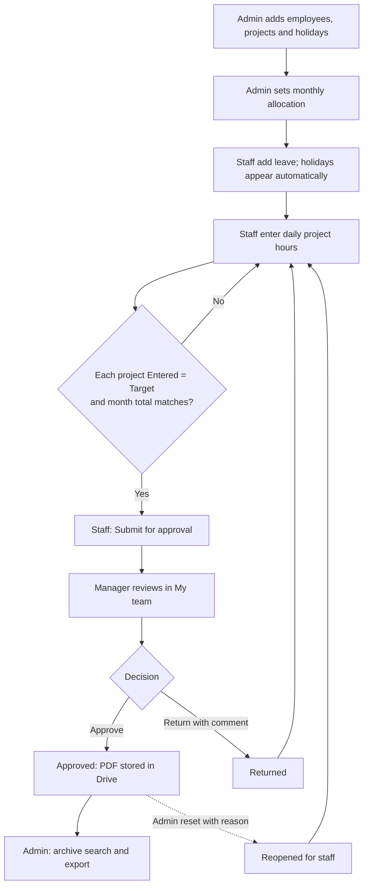
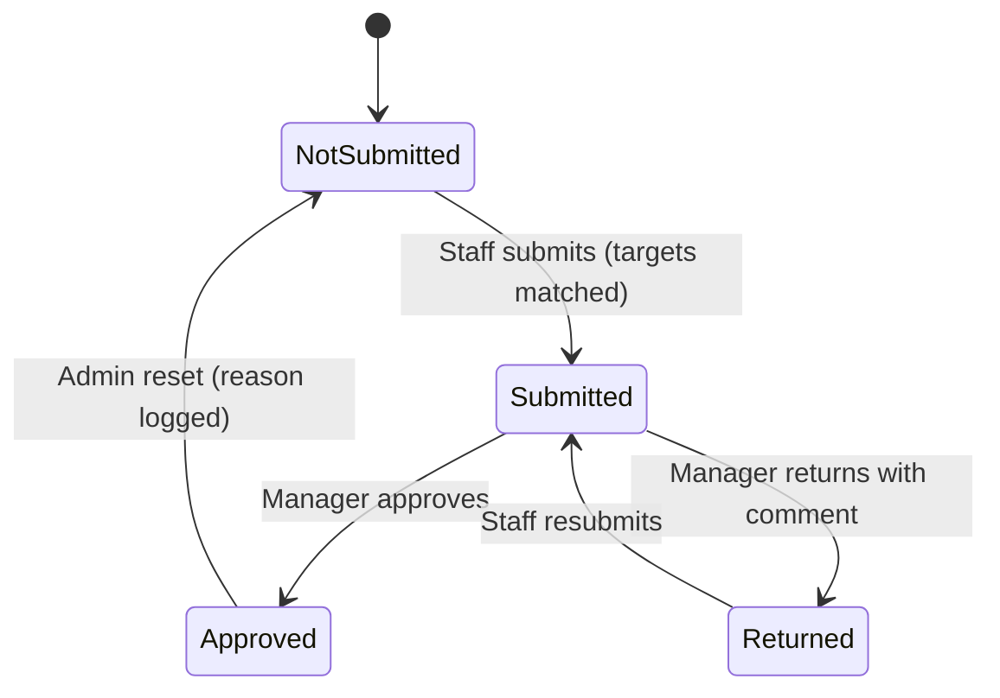
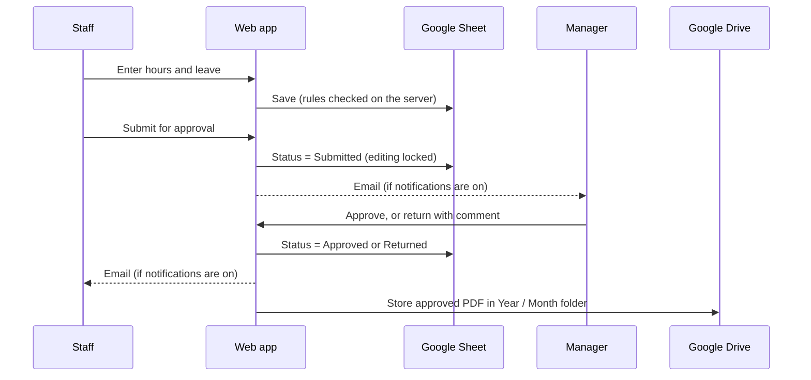

# Runbook 02: Monthly Workflow

## Objective

Describe the monthly cycle from allocation to approval and archive, with the status rules that apply at each step.

---

## Process

---

## Status Rules

- **Editable:** Not submitted, Returned
- **Locked:** Submitted, Approved

---

## Approval Sequence

---

## Daily Rules

| Rule | Enforced on |
|---|---|
| Maximum 8 h per day, minus leave or holiday that day | Server and page |
| Friday and Saturday locked | Server and page |
| Full-day leave or holiday locks the day | Server and page |
| Half-day leave leaves 4 h open | Server and page |
| Each project's entered total equals its target | Server (on save) and page |
| Month total equals total target | Server (on save) and page |

---

## Next

- [Runbook 03: Staff Operations](03-staff-operations.md)
- [Runbook 04: Manager Operations](04-manager-operations.md)
- [Runbook 05: Administrator Operations](05-administrator-operations.md)
