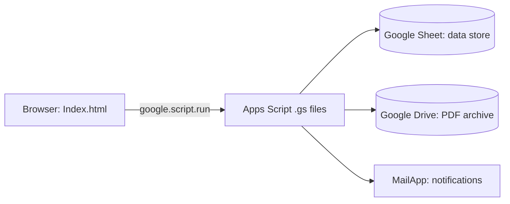

# Architecture

## System overview

## Front end and back end

The page calls server functions with `google.script.run.withSuccessHandler(...).functionName(...)`.

Responses are handled in one place per screen. Each loader checks the month it requested against the month currently shown, and discards answers for a month the user has left. This prevents slow responses from overwriting newer data.

## File responsibilities

| File | Responsibility |
|---|---|
| `Code.gs` | Configuration, sheet helpers, `currentUser()` (sign-in and roles), employee API, bulk employee import |
| `Calc.gs` | Date helpers, leave and holidays by day, `monthReport()` (allocated, adjusted, actual, flags) |
| `Leave.gs` | Leave list, add by date range, delete, daily limit |
| `Actual.gs` | Daily grid data, targets and server-side checks when hours are saved |
| `Workflow.gs` | `setupWorkbook()`, allocation grid and CSV, approve or return, team view, export |
| `Holidays.gs` | Add, list and delete holidays |
| `Notify.gs` | Preferences and email sending |
| `Report.gs` | Submit, month status, PDF build, Drive archive, admin search |
| `Archive.gs` | PDF links, archive index lookup, admin reset |
| `Import.gs` | `withLock_()` helper, and an unused legacy email import |
| `Index.html` | The complete web interface (HTML, CSS and JavaScript) |
| `appsscript.json` | Manifest: time zone, OAuth scopes, web app access |

## Data flow for saving hours

1. The page sends the grid as `{ 'yyyy-mm-dd': { project: hours } }`.
2. `saveActualGrid()` checks the month status, weekend rule, leave-day lock, daily cap, project totals and month total.
3. If any check fails, nothing is written and the error names the problem.
4. If all checks pass, the whole set of web entries for that month is replaced under `withLock_()`.

The page checks the same rules for immediate feedback, but the server is the authority.

## PDF generation

1. `buildReportPdf_()` writes the timesheet into a reusable spreadsheet ("Timesheet PDF workspace").
2. Old images are removed from the workspace before each build, so the logo and any other image appear once.
3. The sheet is exported as a single A4 portrait page, scaled to the page width.
4. Approved PDFs are saved in `Timesheet Reports / Year / Month`. Drafts go to `Drafts`.
5. The file is recorded in the `ReportIndex` tab, which stores its ID.

Chrome blocks printing from the embedded web app, so PDFs open in a new tab.

## Approval and archive

- `submitTimesheet()` writes a *Submitted* row to Approvals and notifies the manager.
- `approveTimesheet()` updates the TimeEntries status, writes the decision and calls `archiveApprovedReport_()`.
- `getReportLink()` returns links to the archived PDF, or builds a draft.
- `resetTimesheet()` removes approval rows, reopens hours, trashes the archived PDF and writes to ResetLog.

## Development workflow

1. Edit files in `src/` (or in the Apps Script editor, then copy back to `src/`).
2. Push with `clasp push`, or paste changes in the editor.
3. Deploy a new version (see [Deployment](deployment.md)).
4. Test with staff, manager and admin accounts.
5. Update `CHANGELOG.md`.
