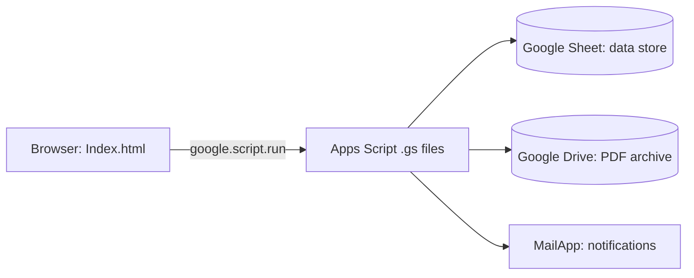

# Reference: Architecture

## Objective

Describe how the parts of the application fit together, for maintainers.

---

## System Overview

---

## File Responsibilities

| File | Responsibility |
|---|---|
| `Code.gs` | Configuration, sheet helpers, `currentUser()` (sign-in and roles), employee API, bulk employee import |
| `Calc.gs` | Date helpers, leave and holidays by day, `monthReport()` |
| `Leave.gs` | Leave list, add by date range, delete, daily limit |
| `Actual.gs` | Daily grid data, targets, server-side checks on save |
| `Workflow.gs` | `setupWorkbook()`, allocation grid and CSV, approve or return, team view, export |
| `Holidays.gs` | Add, list and delete holidays |
| `Notify.gs` | Preferences and email sending |
| `Report.gs` | Submit, month status, PDF build, Drive archive, admin search |
| `Archive.gs` | PDF links, archive index, admin reset |
| `Import.gs` | `withLock_()` helper and an unused legacy email import |
| `Index.html` | Complete web interface (HTML, CSS, JavaScript) |
| `appsscript.json` | Manifest: time zone, OAuth scopes, web app access |

---

## Front End and Back End

The page calls server functions with `google.script.run.withSuccessHandler(...)`. Loaders check the month they requested against the month on screen and discard stale answers, so fast navigation cannot show old data.

---

## Save Flow for Hours

1. The page sends `{ 'yyyy-mm-dd': { project: hours } }`.
2. `saveActualGrid()` checks status, weekends, leave-day locks, daily cap, project totals and month total.
3. If any check fails, nothing is written and the error names the problem.
4. If all pass, the month's web entries are replaced under `withLock_()`.

The page applies the same rules for immediate feedback. The server is the authority.

---

## PDF Flow

1. `buildReportPdf_()` writes the timesheet into the reusable workspace spreadsheet.
2. Images are removed from the workspace before each build.
3. The sheet exports as one A4 portrait page, scaled to the width.
4. Approved PDFs go to `Timesheet Reports / Year / Month`. Drafts go to `Drafts`.
5. The file ID is recorded in `ReportIndex`.
